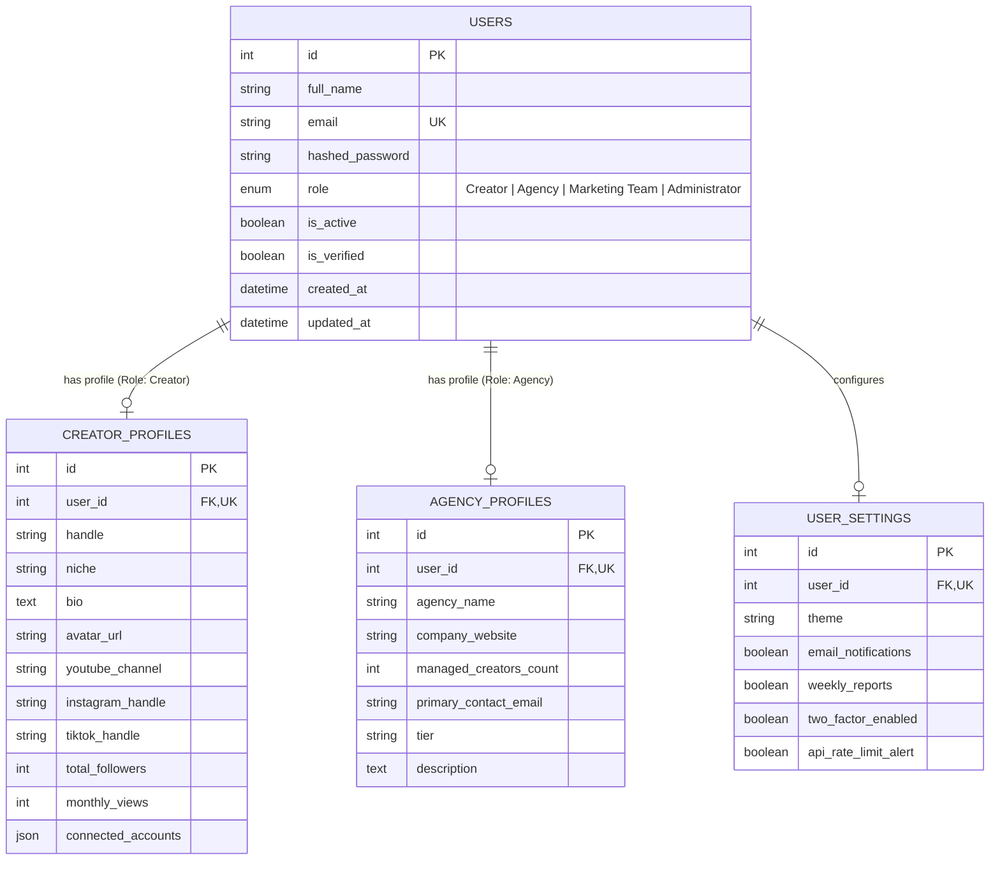

# CreatorIQ: Module 1 - Database Schema Design & Architecture

## 1. Executive Summary
This document outlines the **Database Schema Design** for **Module 1 (User Management Module)** of the **CreatorIQ Platform**. 
The architecture is designed to support scalable multi-tenant social media analytics, creator profile management, agency operations, and granular Role-Based Access Control (RBAC).

---

## 2. Entity-Relationship (ER) Diagram



---

## 3. Relational Schema Data Dictionary

### Table: `users` (Primary Identity Table)
Stores user authentication credentials, account state, and assigned system role.

| Column Name | Data Type | Constraints | Description |
| :--- | :--- | :--- | :--- |
| `id` | `INTEGER` | `PRIMARY KEY, AUTOINCREMENT` | Unique identifier for the user. |
| `full_name` | `VARCHAR(100)` | `NOT NULL` | User's full display name. |
| `email` | `VARCHAR(100)` | `UNIQUE, NOT NULL, INDEX` | Account email address (used for login). |
| `hashed_password` | `VARCHAR(255)` | `NOT NULL` | Bcrypt hashed password string. |
| `role` | `ENUM` | `NOT NULL, DEFAULT 'Creator'` | System role: `Creator`, `Agency`, `Marketing Team`, `Administrator`. |
| `is_active` | `BOOLEAN` | `DEFAULT TRUE` | Account status flag. |
| `is_verified` | `BOOLEAN` | `DEFAULT TRUE` | Email verification status. |
| `created_at` | `TIMESTAMP` | `DEFAULT UTC_NOW` | User account creation timestamp. |
| `updated_at` | `TIMESTAMP` | `DEFAULT UTC_NOW` | Last account update timestamp. |

---

### Table: `creator_profiles` (Role-Specific Profile)
Stores extended analytics metadata, handle handles, and platform connections for Creator accounts.

| Column Name | Data Type | Constraints | Description |
| :--- | :--- | :--- | :--- |
| `id` | `INTEGER` | `PRIMARY KEY, AUTOINCREMENT` | Unique profile ID. |
| `user_id` | `INTEGER` | `FOREIGN KEY(users.id), UNIQUE, NOT NULL` | One-to-One reference to `users.id`. |
| `handle` | `VARCHAR(50)` | `NULLABLE` | Social media main handle (e.g. `@alexrivera`). |
| `niche` | `VARCHAR(100)` | `DEFAULT 'Tech & Content'` | Creator domain category. |
| `bio` | `TEXT` | `NULLABLE` | Creator bio / channel summary. |
| `avatar_url` | `VARCHAR(255)` | `NULLABLE` | Profile picture asset URL. |
| `youtube_channel` | `VARCHAR(100)` | `NULLABLE` | Linked YouTube channel handle. |
| `instagram_handle` | `VARCHAR(100)` | `NULLABLE` | Linked Instagram handle. |
| `tiktok_handle` | `VARCHAR(100)` | `NULLABLE` | Linked TikTok handle. |
| `total_followers` | `INTEGER` | `DEFAULT 0` | Aggregated follower count across platforms. |
| `monthly_views` | `INTEGER` | `DEFAULT 0` | Aggregated 30-day view count. |
| `connected_accounts`| `JSON` | `DEFAULT '[]'` | JSON array of active OAuth integrations. |

---

### Table: `agency_profiles` (Role-Specific Profile)
Stores agency details, roster size, and corporate information for Agency accounts.

| Column Name | Data Type | Constraints | Description |
| :--- | :--- | :--- | :--- |
| `id` | `INTEGER` | `PRIMARY KEY, AUTOINCREMENT` | Unique agency profile ID. |
| `user_id` | `INTEGER` | `FOREIGN KEY(users.id), UNIQUE, NOT NULL` | One-to-One reference to `users.id`. |
| `agency_name` | `VARCHAR(100)` | `NOT NULL` | Registered agency / talent company name. |
| `company_website` | `VARCHAR(150)` | `NULLABLE` | Agency official web address. |
| `managed_creators_count` | `INTEGER` | `DEFAULT 0` | Total number of creators under management. |
| `primary_contact_email` | `VARCHAR(100)` | `NULLABLE` | Business contact email. |
| `tier` | `VARCHAR(50)` | `DEFAULT 'Enterprise Agency'` | Agency tier or plan classification. |
| `description` | `TEXT` | `NULLABLE` | Agency summary and focus areas. |

---

### Table: `user_settings` (User Configuration)
Stores account preferences, notification toggles, and security configurations.

| Column Name | Data Type | Constraints | Description |
| :--- | :--- | :--- | :--- |
| `id` | `INTEGER` | `PRIMARY KEY, AUTOINCREMENT` | Settings record ID. |
| `user_id` | `INTEGER` | `FOREIGN KEY(users.id), UNIQUE, NOT NULL` | One-to-One reference to `users.id`. |
| `theme` | `VARCHAR(20)` | `DEFAULT 'dark'` | UI visual theme preference (`dark`/`light`). |
| `email_notifications` | `BOOLEAN` | `DEFAULT TRUE` | Toggle for email alerts. |
| `weekly_reports` | `BOOLEAN` | `DEFAULT TRUE` | Toggle for automated analytics summaries. |
| `two_factor_enabled` | `BOOLEAN` | `DEFAULT FALSE` | 2FA authentication state. |
| `api_rate_limit_alert`| `BOOLEAN` | `DEFAULT TRUE` | Alert state for API rate thresholds. |

---

## 4. Role-Based Access Control (RBAC) Matrix

| Module / Feature Endpoint | Creator | Agency | Marketing Team | Administrator |
| :--- | :---: | :---: | :---: | :---: |
| `POST /api/v1/auth/login` | ✅ | ✅ | ✅ | ✅ |
| `POST /api/v1/auth/register` | ✅ | ✅ | ✅ | ✅ |
| `GET /api/v1/creator/profile` | ✅ (Own) | ❌ | ❌ | ✅ |
| `PUT /api/v1/creator/profile` | ✅ (Own) | ❌ | ❌ | ✅ |
| `GET /api/v1/agency/profile` | ❌ | ✅ (Own) | ❌ | ✅ |
| `PUT /api/v1/agency/profile` | ❌ | ✅ (Own) | ❌ | ✅ |
| `GET /api/v1/users/` (List All) | ❌ | ❌ | ❌ | ✅ |
| `DELETE /api/v1/users/{id}` | ❌ | ❌ | ❌ | ✅ |
| `PUT /api/v1/settings/` | ✅ | ✅ | ✅ | ✅ |

---

## 5. Standard SQL DDL Creation Script

```sql
-- Enums
CREATE TYPE user_role_enum AS ENUM ('Creator', 'Agency', 'Marketing Team', 'Administrator');

-- Table: Users
CREATE TABLE users (
    id SERIAL PRIMARY KEY,
    full_name VARCHAR(100) NOT NULL,
    email VARCHAR(100) UNIQUE NOT NULL,
    hashed_password VARCHAR(255) NOT NULL,
    role user_role_enum NOT NULL DEFAULT 'Creator',
    is_active BOOLEAN DEFAULT TRUE,
    is_verified BOOLEAN DEFAULT TRUE,
    created_at TIMESTAMP DEFAULT CURRENT_TIMESTAMP,
    updated_at TIMESTAMP DEFAULT CURRENT_TIMESTAMP
);

CREATE INDEX idx_users_email ON users(email);

-- Table: Creator Profiles
CREATE TABLE creator_profiles (
    id SERIAL PRIMARY KEY,
    user_id INT UNIQUE NOT NULL REFERENCES users(id) ON DELETE CASCADE,
    handle VARCHAR(50),
    niche VARCHAR(100) DEFAULT 'Tech & Content',
    bio TEXT,
    avatar_url VARCHAR(255),
    youtube_channel VARCHAR(100),
    instagram_handle VARCHAR(100),
    tiktok_handle VARCHAR(100),
    total_followers INT DEFAULT 0,
    monthly_views INT DEFAULT 0,
    connected_accounts JSONB DEFAULT '[]'::jsonb
);

-- Table: Agency Profiles
CREATE TABLE agency_profiles (
    id SERIAL PRIMARY KEY,
    user_id INT UNIQUE NOT NULL REFERENCES users(id) ON DELETE CASCADE,
    agency_name VARCHAR(100) NOT NULL,
    company_website VARCHAR(150),
    managed_creators_count INT DEFAULT 0,
    primary_contact_email VARCHAR(100),
    tier VARCHAR(50) DEFAULT 'Enterprise Agency',
    description TEXT
);

-- Table: User Settings
CREATE TABLE user_settings (
    id SERIAL PRIMARY KEY,
    user_id INT UNIQUE NOT NULL REFERENCES users(id) ON DELETE CASCADE,
    theme VARCHAR(20) DEFAULT 'dark',
    email_notifications BOOLEAN DEFAULT TRUE,
    weekly_reports BOOLEAN DEFAULT TRUE,
    two_factor_enabled BOOLEAN DEFAULT FALSE,
    api_rate_limit_alert BOOLEAN DEFAULT TRUE
);
```
