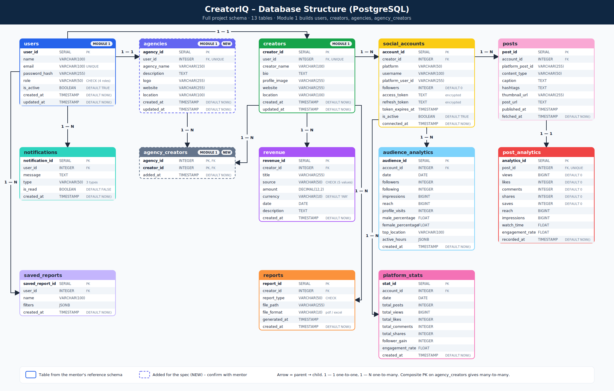
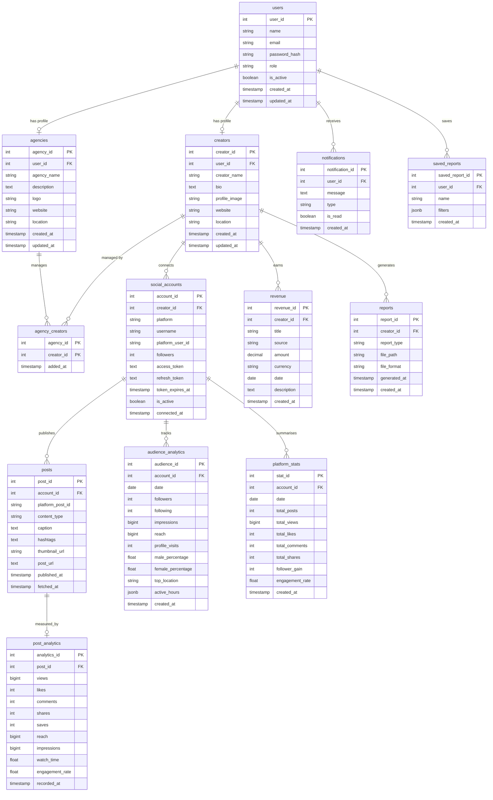

# CreatorIQ – Database Design (PostgreSQL)

Full project schema, designed first and implemented module by module.
The SQL for everything below is in `database/schema.sql`.

Source: mentor's "Final Database Structure" reference (11 tables) plus 2 additions needed by the spec.

## 1. Schema diagram

Image files: `docs/schema_diagram.png` (for slides and reports) and `docs/schema_diagram.svg` (scalable). Colors follow the mentor's reference; dashed boxes are additions.

The same schema as a Mermaid ER diagram (renders on GitHub):

## 2. Relationships

| From | To | Type | Meaning |
|---|---|---|---|
| users | creators | 1 : 1 | a creator user has one creator profile |
| users | agencies | 1 : 1 | an agency user has one agency profile |
| agencies | creators | M : N (`agency_creators`) | creators an agency manages |
| creators | social_accounts | 1 : N | one creator connects many platform accounts |
| social_accounts | posts | 1 : N | an account has many posts |
| posts | post_analytics | 1 : 1 | metrics for each post |
| social_accounts | audience_analytics | 1 : N | one row per account per day |
| social_accounts | platform_stats | 1 : N | daily totals per account |
| creators | revenue | 1 : N | earnings entries |
| creators | reports | 1 : N | generated report files |
| users | notifications | 1 : N | alerts for a user |
| users | saved_reports | 1 : N | saved report filters |

## 3. Which module uses which tables

| Module | Tables |
|---|---|
| 1. User Management | users, creators, agencies, agency_creators |
| 2. Content Analytics | posts, post_analytics |
| 3. Audience Analytics | audience_analytics |
| 4. Growth & Trend Analysis | platform_stats, posts (hashtags) |
| 5. Revenue Analytics | revenue |
| 6. Social Media Integration | social_accounts (+ fills posts, analytics tables) |
| 7. Analytics Dashboard | reads from the tables above |
| 8. Notification & Reporting | notifications |
| 9. Reports & Export | reports, saved_reports |

## 4. Roles (implemented in Module 1)

`users.role` is a VARCHAR with a CHECK constraint, as in the reference:

| Value | Role | Profile table |
|---|---|---|
| creator | Creator | creators |
| agency | Agency | agencies |
| marketing_team | Marketing Team | none yet |
| admin | Administrator | none |

Signup allows only `creator` and `agency`. `marketing_team` and `admin` are assigned by an admin (User Management page or `PATCH /api/admin/users/{id}`).

The database enforces the four values with the CHECK constraint `ck_users_role`. The API returns `role` (stored value) and `role_label` (display name).

## 5. Design decisions

1. **Table and column names follow the mentor's reference** (`user_id`, `password_hash`, `creators`, etc.).
2. **Passwords are stored only as bcrypt hashes** in `password_hash`.
3. **Email is UNIQUE** and stored lowercase.
4. **Profiles are separate tables** with a UNIQUE `user_id`, so `users` stays small and login lookups are fast.
5. **ON DELETE CASCADE** from users down to everything that belongs to them.
6. **Extra constraints added to the reference**: UNIQUE `(platform, platform_user_id)` on social_accounts, UNIQUE `(account_id, platform_post_id)` on posts, UNIQUE `(account_id, date)` on audience_analytics and platform_stats. They stop duplicate rows when data is synced more than once.
7. **CHECK constraints** on role, revenue source, report type and format, and notification type, so bad values cannot be stored.
8. **Social tokens** (`access_token`, `refresh_token`) must be encrypted by the application before saving.
9. **Indexes** on foreign keys and on (account, date) lookups used by dashboard charts.

## 6. Additions to the reference (to confirm with mentor)

- **agencies** and **agency_creators**: the spec asks for Agency profile management and the Agency dashboard lists the creators it manages, but the reference has no table for it.
- **Marketing Team** role: in the spec, but the reference role comment lists only creator / agency / admin.

## 7. Gaps noticed in the reference (open questions)

- The Agency and Marketing dashboards show **campaigns** (Active Campaigns, Top Performing Campaigns), but there is no `campaigns` table.
- The Admin dashboard shows **System Activity** and **Platform Usage**, which need an activity log table.

Not added to the schema yet. Needs the mentor's decision.

## 8. Implementation status

| Tables | Status |
|---|---|
| users, creators, agencies, agency_creators | Implemented in Module 1 (SQLAlchemy models + Alembic migration `0001`) |
| The other 9 tables | Designed here, built in later modules |

Create the Module 1 tables with `alembic upgrade head` (see `backend/alembic/versions/0001_module_1_schema.py`).
