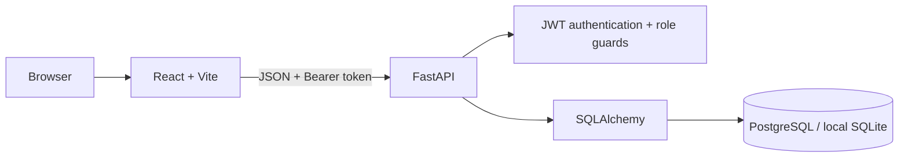

# CreatorIQ — Milestone 1 Architecture & Workflow Plan

## Objective
Provide creators with one workspace for account access, performance KPIs, a seven-day trend chart, platform comparison, and top-performing content. Current analytics are seeded demo records; social-platform OAuth/API ingestion is Milestone 2 work.

## Architecture

- **Frontend:** React, Vite, Recharts, Axios.
- **Backend:** FastAPI REST API, Pydantic request/response validation, password hashing, signed JWT access tokens.
- **Data layer:** SQLAlchemy models; PostgreSQL is configured for Docker Compose, while SQLite is the local no-setup fallback.
- **Authorization:** dashboard routes require a valid JWT and the `dashboard:read` + `analytics:read` permissions. Administrator user creation, listing, and role changes require the `administrator` role. Public registration allows `creator`, `agency`, and `marketing_team`; the `administrator` role is not offered on public signup.
- **Demo scope:** seeded values are not live social-network data. The application must not claim that platform accounts are connected.

## Database entities

`users` 1—1 `creator_profiles`, `agency_profiles`, or `marketing_team_profiles` according to role; `creator_profiles` 1—many `social_accounts`; `social_accounts` 1—many `content_posts`; `content_posts` 1—many `content_metrics`; `social_accounts` 1—many `audience_insights`; `creator_profiles` 1—many `revenue_records`, `notifications`, and `reports`.

The authoritative runtime schema is defined by `backend/app/models.py`. `schema/postgresql_schema.sql` is the PostgreSQL reference DDL and `schema/creatoriq_er_diagram.png` is the visual ER model. Page hierarchy and interaction planning are in `docs/ui-wireframe-plan.md`.

## Core workflow: registration and sign-in

1. User selects Creator, Agency, or Marketing Team and enters name, email, password, profile/workspace name, and the role-specific focus area.
2. API validates input, normalizes the email, rejects duplicates, hashes the password, and creates the role plus matching profile record (`creator_profiles`, `agency_profiles`, or `marketing_team_profiles`) in one transaction. The public API rejects the `administrator` role.
3. Login verifies the stored password hash and returns a signed, time-limited JWT.
4. Frontend stores the token for this development prototype and sends it in the `Authorization: Bearer` header.
5. Protected API dependency decodes and validates the token and checks that the user still exists and is active.
6. Logout clears the local token and user state; the next protected request without a token receives `401`.

## Core workflow: dashboard data

1. Frontend loads summary, daily trends, platform comparison, and top content in parallel.
2. Each endpoint resolves the authenticated user and that user's creator profile.
3. SQL queries filter through the profile's social accounts so one creator cannot read another creator's analytics.
4. KPI/chart responses are rendered in the React dashboard. Empty profiles receive empty/zero analytics rather than another creator's sample records.

## Core workflow: role checks

- `creator`, `agency`, `marketing_team`, and `administrator` are valid roles.
- Public registration offers the three standard workspace roles; Administrator accounts are seeded for local review or created by an existing administrator.
- Each standard role gets a separate role-appropriate profile table. Agency and marketing team profiles are not stored as creator profiles.
- `GET /api/auth/permissions` returns the current account's role and permission names.
- `GET /api/admin/users`, `POST /api/admin/users`, and `PATCH /api/admin/users/{id}/role` are administrator-only.
- `GET/PATCH /api/account/profile` and `POST /api/account/password` provide account settings. Current password verification is required to change a password.
- Full multi-client agency management and campaign workflows are planned for later milestones; the first milestone implements the role-aware account/profile foundation.

## Milestone 1 acceptance checklist

- [x] React frontend and FastAPI backend initialization.
- [x] Registration, login, hashed passwords, expiring JWTs, protected API routes.
- [x] Role field, role-specific profile tables, public-registration privilege restriction, administrator-only account creation/listing/role changes, and account settings.
- [x] Creator dashboard KPIs, seven-day trend visualization, platform comparison, and top-content table.
- [x] SQLAlchemy database models and ER diagram.
- [x] Architecture and workflows written down.
- [x] Automated API test suite added for auth, protected access, role enforcement, and creator data isolation (execute `pytest` before review).
- [ ] Real platform OAuth/API integration, advanced audience reporting, and live syncing — **Milestone 2**, per the project plan.

## Demo accounts (local review only)

- Creator: `demo@creatoriq.dev` / `CreatorIQ@123`
- Administrator: `admin@creatoriq.dev` / `CreatorIQAdmin@123`

Do not use these demo credentials or the development JWT secret in production.
